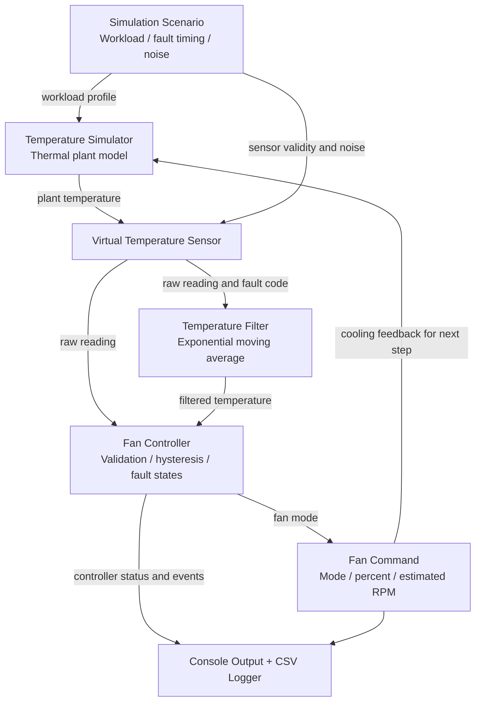
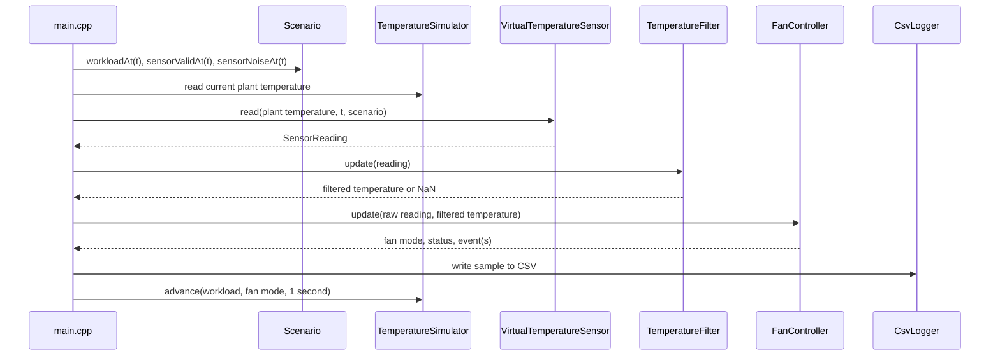
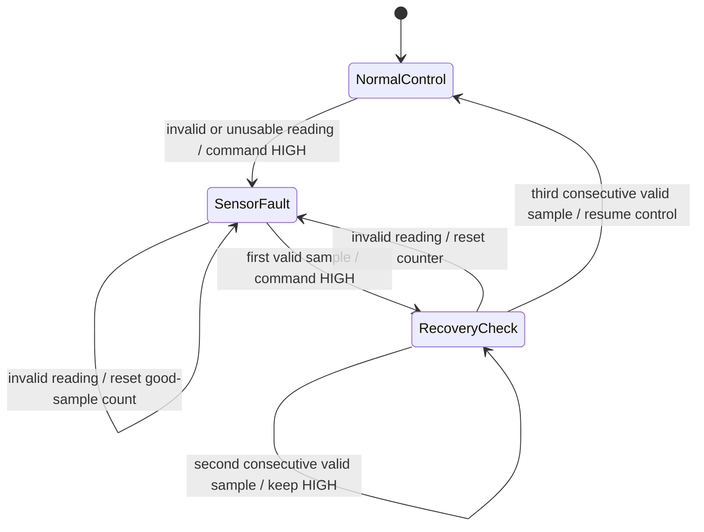

# VirtualTherm

### A software-only embedded cooling controller simulation in C++17

VirtualTherm models the core logic of an embedded controller that monitors a machine's temperature and adjusts a cooling fan. It simulates the thermal system, virtual sensor readings, temperature filtering, fan control, fault responses, console diagnostics, and CSV logging—all on a desktop computer.

> **Important scope note:** VirtualTherm is an educational simulation, not production firmware. It has not been connected to a physical sensor, fan, or microcontroller, and its thermal constants and protection thresholds have not been validated against real equipment. Fan RPM values are estimates selected by the simulation, not measured speeds.

---

## Contents

- [At a glance](#at-a-glance)
- [Why this project exists](#why-this-project-exists)
- [Features](#features)
- [Visual system architecture](#visual-system-architecture)
- [How one simulation step works](#how-one-simulation-step-works)
- [Project layout](#project-layout)
- [Modules explained](#modules-explained)
- [Thermal model](#thermal-model)
- [Sensor simulation and noise](#sensor-simulation-and-noise)
- [Temperature filtering](#temperature-filtering)
- [Fan-control rules](#fan-control-rules)
- [Controller statuses and fault handling](#controller-statuses-and-fault-handling)
- [Simulation scenarios](#simulation-scenarios)
- [Build and run](#build-and-run)
- [Command-line options](#command-line-options)
- [Console output and run summary](#console-output-and-run-summary)
- [CSV logging](#csv-logging)
- [Testing and verification](#testing-and-verification)
- [Design choices and trade-offs](#design-choices-and-trade-offs)
- [Limitations and future improvements](#limitations-and-future-improvements)
- [Interview preparation](#interview-preparation)
- [Glossary](#glossary)
- [License](#license)

---

## At a glance

| Item | Description |
|---|---|
| Project name | VirtualTherm |
| Language | C++17 |
| Build system | CMake 3.16+ |
| External libraries | None required; C++ standard library only |
| Hardware required | None |
| Main idea | Simulate a temperature-controlled cooling fan |
| Sensor filtering | Exponential moving average (EMA) |
| Control method | Fan-mode state machine with hysteresis |
| Fault behavior | Command simulated fan HIGH when sensor data is unusable |
| Recovery rule | Three consecutive valid readings before leaving sensor-fault state |
| Critical-temperature behavior | Latched critical status with a separate reset threshold |
| Reproducible scenarios | Normal, overheat, sensor-fault, workload-spike, noisy-sensor |
| Data output | Console and CSV file |
| Automated tests | Lightweight in-project C++ test executable, run with CTest |

## Why this project exists

Embedded software often repeatedly reads input signals, validates measurements, makes control decisions, and drives outputs. This project lets you practise those ideas without needing to purchase development boards or sensors.

VirtualTherm represents a fictional device that generates heat under workload. A controller observes a virtual temperature sensor and commands a fan to run at one of four levels. The fan's simulated cooling then affects the device's future temperature.

The project is intentionally limited in scope. It focuses on explaining and testing the control loop rather than adding a web interface, cloud service, or large user-interface framework.

### What is simulated—and what is real?

| Part | In this project |
|---|---|
| Temperature | Calculated by a simplified software model |
| Sensor | A C++ class that returns a simulated reading |
| Sensor noise | Deterministic mathematical variation in one scenario |
| Fan control | Real C++ decision logic running on the host computer |
| Fan speed and RPM | A simulated command and fixed estimate for each mode |
| Faults | Reproducible software-injected conditions |
| Logging and tests | Real file output and executable test code |
| Microcontroller, physical fan, physical sensor | Not present |

---

## Features

- **Modular C++17 design:** Each major responsibility is separated into a small class or module.
- **Closed-loop simulation:** Workload heats the virtual device; the selected fan mode changes the cooling rate.
- **Four fan modes:** OFF, LOW, MEDIUM, and HIGH.
- **EMA signal filtering:** Smooths small measurement variations while maintaining a responsive control path.
- **Hysteresis:** Uses different rising and falling thresholds to reduce unnecessary mode switching.
- **Critical-temperature latch:** Keeps a critical condition active until the temperature has cooled to a lower reset threshold.
- **Sensor validation:** Detects explicit invalid readings, non-finite values, and values outside the accepted range.
- **Fault recovery debounce:** Requires three consecutive valid samples before leaving sensor-fault status.
- **Five deterministic scenarios:** Provides repeatable operating conditions for manual and automated tests.
- **CSV diagnostics:** Saves temperature, workload, controller status, fan output, and events per simulation step.
- **Run summary:** Reports peaks, averages, mode durations, state counts, transitions, and event rows.
- **Automated tests:** Checks individual rules and end-to-end scenarios without a third-party test framework.
- **Command-line controls:** Select the scenario, number of simulated seconds, CSV path, and console verbosity.

---

## Visual system architecture

The following diagram shows the main data path and the feedback connection between the simulated fan command and the thermal model.



### The control loop in plain English

1. A scenario supplies the current workload.
2. The thermal model computes the device's current simulated temperature.
3. The virtual sensor reports that temperature, possibly with noise or a simulated disconnect.
4. The filter smooths a valid sensor reading. If the input is invalid, the filter clears its history.
5. The fan controller validates the input, updates its internal state, and chooses a fan mode.
6. The program records the sample and any state-change events.
7. The chosen fan mode affects cooling in the next simulation step.
8. The process repeats until the requested number of simulated seconds has been processed.

This is a **feedback system**: the fan command changes the temperature that will be measured in later steps.

## How one simulation step works



The default step represents **one simulated second**, but the program runs as quickly as the host computer allows. The optional `--realtime` argument pauses for one real second after each step; this paces the simulation but does not make it a hard real-time system.

---

## Project layout

```text
VirtualTherm/
├── CMakeLists.txt
├── README.md
├── START_HERE.txt
├── LICENSE
├── .gitignore
├── build_windows.bat
├── build_unix.sh
├── include/
│   └── virtualtherm/
│       ├── types.hpp
│       ├── scenario.hpp
│       ├── temperature_simulator.hpp
│       ├── virtual_sensor.hpp
│       ├── temperature_filter.hpp
│       ├── fan_controller.hpp
│       └── csv_logger.hpp
├── src/
│   ├── main.cpp
│   ├── scenario.cpp
│   ├── temperature_simulator.cpp
│   ├── virtual_sensor.cpp
│   ├── temperature_filter.cpp
│   ├── fan_controller.cpp
│   └── csv_logger.cpp
├── tests/
│   └── test_main.cpp
├── docs/
│   ├── architecture.md
│   ├── test_plan.md
│   └── interview_guide.md
└── examples/
    ├── normal_run.csv
    ├── overheat_run.csv
    ├── sensor_fault_run.csv
    ├── workload_spike_run.csv
    └── noisy_sensor_run.csv
```

### What the folders contain

- `include/virtualtherm/`: Public interfaces, enums, and data structures used by the other modules.
- `src/`: The implementations and command-line application.
- `tests/`: Automated checks for controller behavior, filters, scenarios, and the thermal model.
- `docs/`: Extra architecture notes, test plan, and interview guide.
- `examples/`: Previously generated CSV output for the five scenarios. These files are examples, not a substitute for running the tests yourself.

---

## Modules explained

### 1. `types.hpp` — shared data types

This file defines the types used throughout the program so that different modules share the same vocabulary.

| Type | Purpose |
|---|---|
| `FanMode` | `Off`, `Low`, `Medium`, or `High` |
| `ControllerStatus` | `Normal`, `Warning`, `Critical`, or `SensorFault` |
| `Scenario` | Identifies one of the five simulation profiles |
| `SensorReading` | Contains validity, temperature, and optional fault code |
| `ControllerOutput` | Contains the chosen fan mode, controller status, and event string |
| `SimulationSample` | Complete record for one simulated second, including model state and outputs |

Useful helper functions convert enum values to text and map fan mode to simulated fan percentage and estimated RPM. Keeping these mappings in one place prevents each module from hard-coding a different interpretation of a fan mode.

### 2. `scenario.cpp` — scenario profiles

`SimulationScenario` provides three time-dependent inputs:

- `workloadAt(t)`: normalized workload from 0.0 to 1.0;
- `sensorValidAt(t)`: whether the sensor is available at a given time;
- `sensorNoiseAt(t)`: deterministic measurement perturbation.

The workload profile is selected once on startup through `--scenario`. Each profile is deterministic, so it can be reproduced during a later test or interview demonstration.

### 3. `temperature_simulator.cpp` — the virtual thermal plant

This class stores the current plant temperature and ambient temperature. Every step it advances the model based on workload, current fan mode, and a time step.

The model is deliberately simple and is not calibrated to a specific machine. It gives the controller a changing environment to respond to.

### 4. `virtual_sensor.cpp` — the virtual sensor interface

The sensor receives the simulated plant temperature and scenario information. It can:

- return a normal reading;
- add deterministic noise when the `noisy-sensor` scenario is active;
- return an invalid reading with a fault code during the injected disconnect;
- reject a non-finite model temperature.

This boundary makes it clear where a physical sensor driver could eventually be introduced. However, the current implementation does not communicate with any device.

### 5. `temperature_filter.cpp` — signal smoothing

`TemperatureFilter` implements an exponential moving average. It stores its latest filtered value and whether it has been initialized. The first valid sample initializes the filter; subsequent valid samples update it. An invalid or out-of-range sample resets the filter so old history is not silently reused after sensor recovery.

### 6. `fan_controller.cpp` — control decisions and protection behavior

This is the core of VirtualTherm. It:

1. checks the raw reading and filtered temperature for validity;
2. enters sensor-fault mode and commands HIGH if the input is not usable;
3. requires three consecutive valid readings before leaving a sensor fault;
4. checks the critical-temperature threshold and latch reset condition;
5. chooses fan mode using the thresholds and hysteresis;
6. reports state transitions and fault events.

The controller is **stateful**: the correct next fan mode depends on the current fan mode as well as the temperature. That is why the same temperature can result in different fan modes while warming up versus cooling down.

### 7. `csv_logger.cpp` — data recording

`CsvLogger` creates the output file, writes the header, and appends one row per simulated sample. It quotes strings when they contain commas, quotes, or line breaks so they can be represented as valid CSV fields. Invalid temperature values are left blank rather than written as real zero-degree readings.

### 8. `main.cpp` — orchestration and command line

The application entry point parses arguments, constructs all modules, then runs the simulation loop. It sends each sample to the CSV logger and prints a periodic console view. Events are printed immediately even if they occur between periodic output lines.

After the loop, `main.cpp` prints a summary with temperature statistics, fan-mode duration, status counts, invalid sample counts, mode transitions, and event rows.

### 9. `tests/test_main.cpp` — automated checks

The tests exercise individual control rules as well as end-to-end behavior. The test executable uses small local check helpers, so no external testing framework is required.

---

## Thermal model

The simulated plant has a default ambient temperature of **25°C**. Each iteration represents a one-second time step unless another time step is supplied directly to the model.

The model uses a simple heating/cooling relationship:

\[
T_{new} = T_{old} + (H - C)\,\Delta t
\]

Where:

- \(T_{old}\) is the plant temperature at the start of the step;
- \(T_{new}\) is the updated plant temperature;
- \(H\) is heat generation due to workload;
- \(C\) is cooling due to ambient losses and fan action;
- \(\Delta t\) is the model time step.

The implementation is equivalent to:

\[
H = 0.90\,W
\]

\[
C = (0.006 + 0.006F)(T_{old}-T_{ambient})
\]

Here, \(W\) is workload clamped to the range 0–1, and \(F\) is fan command as a fraction from 0.0 to 1.0. For example, a 65% command gives \(F=0.65\).

After updating, temperature is constrained to remain between the ambient temperature and 150°C. This keeps the simple model within the intended range.

### How to interpret it

- Higher workload produces more heating.
- A higher fan command increases the cooling coefficient.
- When the model is above ambient, cooling becomes stronger as the temperature gap grows.
- The fan output chosen in one step affects cooling in the next step.

The coefficients are **illustrative software-model parameters**. They should not be interpreted as measured thermal properties or used to size a real cooling system.

---

## Sensor simulation and noise

A valid reading is represented by `SensorReading` with `valid = true`, a numeric Celsius value, and an empty fault code. A failed sensor reading uses `valid = false`, a non-finite temperature, and a fault reason such as `SIMULATED_SENSOR_DISCONNECT`.

In the `noisy-sensor` scenario, the sensor adds deterministic noise:

\[
N(t) = \sin(0.73t) + 0.35\sin(1.91t)
\]

The units of the perturbation are degrees Celsius. Because the function only depends on simulated time, the same timestamp produces the same noise on every run. This is useful for repeatable testing.

In the `sensor-fault` scenario, the reading is invalid for simulation times **35 through 44 inclusive**—ten samples in total. The sensor becomes available again at time 45.

---

## Temperature filtering

The project uses an **exponential moving average (EMA)** with \(\alpha = 0.35\).

\[
T_f(t) = \alpha T_r(t) + (1-\alpha)T_f(t-1)
\]

- \(T_r(t)\): current raw reading;
- \(T_f(t)\): updated filtered reading;
- \(T_f(t-1)\): previous filtered reading;
- \(\alpha\): smoothing factor.

The first valid sample initializes the filter directly. Later valid readings update the estimate. If input is invalid or outside the accepted temperature range, the filter resets and returns a non-finite value until a valid reading initializes it again.

### Worked example

Suppose the previous filtered temperature is 40°C and the next raw reading is 50°C:

\[
T_f = 0.35(50) + 0.65(40) = 43.5^\circ C
\]

The filtered value moves part of the way toward the new sample instead of jumping directly to 50°C.

### Trade-off

A larger \(\alpha\) responds more quickly but smooths less. A smaller \(\alpha\) smooths more but introduces more lag. VirtualTherm checks the raw reading separately for critical over-temperature so that a high raw sample does not have to wait for the EMA to catch up.

---

## Fan-control rules

The controller emits one of four fan modes. Their percentages and RPM estimates are model outputs:

| Fan mode | Command | Estimated RPM |
|---|---:|---:|
| OFF | 0% | 0 |
| LOW | 35% | 800 |
| MEDIUM | 65% | 1,400 |
| HIGH | 100% | 2,000 |

These values are fixed mappings in the simulation. They are not readings from a real fan tachometer.

### Rising-temperature thresholds

Normal fan-mode selection uses the **filtered temperature**. If the temperature is rising, the thresholds are:

| Current mode | Transition when the filtered temperature rises |
|---|---|
| OFF | LOW at 40°C; MEDIUM at 55°C; HIGH at 70°C |
| LOW | MEDIUM at 55°C; HIGH at 70°C |
| MEDIUM | HIGH at 70°C |
| HIGH | Remain HIGH until a falling threshold is reached |

An OFF fan can jump directly to MEDIUM or HIGH when the sampled temperature is already above those thresholds; it does not need to pass through each mode one step at a time.

### Falling-temperature thresholds (hysteresis)

The thresholds for reducing speed are lower than the thresholds for increasing speed:

| Current mode | Falling-temperature transition |
|---|---|
| LOW | OFF at 37°C or below |
| MEDIUM | OFF at 37°C or below; LOW at 52°C or below |
| HIGH | OFF at 37°C or below; LOW at 52°C or below; MEDIUM at 67°C or below |

Hysteresis helps prevent rapid switching around a single boundary. For example, a fan that has entered LOW at 40°C does not turn OFF again until temperature reaches 37°C or below.

---

## Controller statuses and fault handling

Fan mode and controller status are two different things. The mode describes the commanded fan speed; the status describes what the controller believes is happening.

| Status | Meaning | Fan behavior |
|---|---|---|
| `NORMAL` | Temperature is below the warning threshold and there is no active critical latch or sensor fault | Controlled by normal fan rules |
| `WARNING` | Filtered temperature is at or above 55°C, without a critical latch | Controlled by normal fan rules |
| `CRITICAL` | Raw or filtered temperature has reached 78°C and the critical condition remains latched | HIGH |
| `SENSOR_FAULT` | Sensor data is invalid, non-finite, or outside the accepted range | HIGH |

### Input validity

The controller accepts temperature values from **-40°C through 150°C**, inclusive, if the reading is explicitly marked valid and finite. It also validates the filtered temperature. An invalid raw or filtered reading forces `SENSOR_FAULT` and HIGH fan command.

### Critical-temperature latch

1. If raw temperature or filtered temperature reaches **78°C or higher**, set the critical latch.
2. While latched, set status to `CRITICAL` and command HIGH.
3. Do not clear the latch just because temperature briefly falls below 78°C.
4. Clear the latch only when **both** raw and filtered temperatures are **72°C or below**.
5. Emit a `CRITICAL_TEMPERATURE_CLEARED` event when the latch clears.

This difference between a trip threshold (78°C) and a reset threshold (72°C) provides hysteresis for the critical state.

### Sensor fault and recovery



Operationally:

- An invalid sample immediately commands HIGH and sets `SENSOR_FAULT`.
- When valid readings return, the controller counts consecutive good samples.
- The fan remains HIGH while the first and second good samples are observed.
- The third consecutive valid sample allows the controller to leave sensor-fault status and resumes temperature-based control, unless the critical-temperature latch still requires HIGH.
- If an invalid sample appears during recovery, the counter resets.

The three-sample rule is a demonstration of recovery debounce. It is not a universal safety standard. A real product must decide the proper fail-safe action through a safety or hazard analysis.

### Events

The controller can add event labels when a fault or important transition occurs. Examples include:

- `SENSOR_FAULT:SIMULATED_SENSOR_DISCONNECT`
- `SENSOR_RECOVERY_STARTED`
- `SENSOR_RECOVERED`
- `CRITICAL_TEMPERATURE_CLEARED`
- `FAN_LOW_TO_MEDIUM`
- `STATUS_NORMAL_TO_WARNING`

If multiple events occur during a single step, they are joined with semicolons in the event field.

---

## Simulation scenarios

Use `--scenario` to pick one of five profiles. A scenario fixes the workload schedule, sensor validity, and noise pattern for repeatable tests.

### 1. `normal`

A changing workload profile intended to exercise ordinary fan control and temperature recovery.

| Simulation time | Workload |
|---|---:|
| 0–9 s | 0.25 |
| 10–29 s | 0.55 |
| 30–69 s | 0.70 |
| 70–94 s | 0.30 |
| 95 s onward | 0.20 |

### 2. `overheat`

Sustained heavy workload exercises fan escalation and the critical-temperature latch.

| Simulation time | Workload |
|---|---:|
| 0–9 s | 0.30 |
| 10–109 s | 1.00 |
| 110 s onward | 0.20 |

The test is intended to demonstrate the controller's response; the exact simulated temperature trajectory follows the thermal model and fan feedback.

### 3. `sensor-fault`

Exercises fail-safe output and recovery after sensor disconnection.

| Simulation time | Workload | Sensor |
|---|---:|---|
| 0–9 s | 0.30 | Valid |
| 10–34 s | 0.65 | Valid |
| 35–44 s | 0.45 | Invalid disconnect |
| 45–59 s | 0.45 | Valid again |
| 60 s onward | 0.25 | Valid |

The ten invalid readings are injected at seconds 35 through 44. After the sensor becomes valid, the fan remains HIGH during recovery validation until the third consecutive valid sample.

### 4. `workload-spike`

Models a sudden high-demand period followed by a reduction in workload.

| Simulation time | Workload |
|---|---:|
| 0–19 s | 0.18 |
| 20–54 s | 1.00 |
| 55–84 s | 0.18 |
| 85 s onward | 0.35 |

### 5. `noisy-sensor`

Uses the same workload schedule as `normal`, but adds deterministic temperature noise so the EMA filter and fan hysteresis can be observed under fluctuating input.

---

## Build and run

### Requirements

- C++17-capable compiler: MSVC, GCC, or Clang;
- CMake 3.16 or newer;
- a terminal or shell.

No physical hardware, device driver, or external C++ package is required. The project uses the C++ standard library.

### Windows (Visual Studio / MSVC)

Open Developer PowerShell or a terminal where CMake and the Visual Studio C++ compiler are available. From the project root, run:

```powershell
cmake -S . -B build
cmake --build build --config Release
ctest --test-dir build -C Release --output-on-failure
```

With the common Visual Studio generator, the executable is normally at `build\Release\virtualtherm.exe`:

```powershell
.\build\Release\virtualtherm.exe --scenario normal --steps 150 --csv examples\my_normal_run.csv
```

The test executable is normally under `build\Release\virtualtherm_tests.exe`.

If you use a single-configuration generator and the executable is placed directly under `build`, run `build\virtualtherm.exe` instead.

### Linux or macOS

```bash
cmake -S . -B build -DCMAKE_BUILD_TYPE=Release
cmake --build build
ctest --test-dir build --output-on-failure
./build/virtualtherm --scenario normal --steps 150 --csv examples/my_normal_run.csv
```

### Convenience scripts

- Windows: `build_windows.bat`
- Linux/macOS: `build_unix.sh`

The scripts are convenience wrappers around the CMake build. The compiler and CMake must already be installed and available to the shell.

### First run recommendation

Start with the `normal` scenario, then run `overheat` and `sensor-fault`. Compare the console output with the CSV file. It is more valuable to understand why the fan mode changes than to run every option immediately.

---

## Command-line options

The main executable supports:

| Argument | Default | Purpose |
|---|---|---|
| `--scenario NAME` | `normal` | Select `normal`, `overheat`, `sensor-fault`, `workload-spike`, or `noisy-sensor` |
| `--steps N` | `150` | Number of simulated seconds; valid range is 1–36000 |
| `--csv PATH` | `virtualtherm_output.csv` | Where to write the CSV output; its parent directory must already exist |
| `--realtime` | Disabled | Pause one real second after every simulated second |
| `--quiet` | Disabled | Suppress per-step console rows and print only the final summary |
| `--help` or `-h` | — | Print usage information |

Unknown options, unknown scenario names, missing option values, or invalid step counts produce an error. A CSV path cannot create missing parent directories automatically, so ensure the destination folder exists.

### Copy-paste demo commands

Windows, using the Visual Studio generator:

```powershell
.\build\Release\virtualtherm.exe --scenario normal --steps 150 --csv examples\normal_demo.csv
.\build\Release\virtualtherm.exe --scenario overheat --steps 150 --csv examples\overheat_demo.csv
.\build\Release\virtualtherm.exe --scenario sensor-fault --steps 90 --csv examples\sensor_fault_demo.csv
.\build\Release\virtualtherm.exe --scenario workload-spike --steps 150 --csv examples\workload_spike_demo.csv
.\build\Release\virtualtherm.exe --scenario noisy-sensor --steps 150 --csv examples\noisy_sensor_demo.csv
```

Linux/macOS, after building:

```bash
./build/virtualtherm --scenario normal --steps 150 --csv examples/normal_demo.csv
./build/virtualtherm --scenario overheat --steps 150 --csv examples/overheat_demo.csv
./build/virtualtherm --scenario sensor-fault --steps 90 --csv examples/sensor_fault_demo.csv
./build/virtualtherm --scenario workload-spike --steps 150 --csv examples/workload_spike_demo.csv
./build/virtualtherm --scenario noisy-sensor --steps 150 --csv examples/noisy_sensor_demo.csv
```

Use a different output filename if you want to preserve the sample CSV files committed under `examples/`.

---

## Console output and run summary

During a run, the program prints a table containing:

- `TIME`: simulated time in seconds;
- `LOAD`: normalized workload;
- `RAW C`: raw sensor temperature, or `INVALID` on a failed sample;
- `FILTER C`: filtered temperature, or `--` when unavailable;
- `FAN`: current mode and command percentage;
- `RPM*`: estimated RPM from the fan-mode mapping;
- `STATUS`: controller state;
- `EVENT`: event string for any change or fault on that sample.

In normal console mode, the program prints every fifth simulated second, the last sample, and any step containing an event. This keeps the display readable without hiding state transitions.

The final summary includes:

- scenario and number of samples;
- final and peak plant temperature;
- peak and average valid raw sensor temperature;
- final controller status and fan command;
- average fan command percentage;
- number of seconds in each fan mode;
- counts of samples in each controller status;
- number of invalid sensor samples;
- fan-mode transition count;
- number of rows containing an event;
- CSV file path.

The summary is diagnostic output for the simulated run, not evidence of performance on physical hardware.

---

## CSV logging

Each simulation run writes one row per simulated sample plus a header row. The file begins with these columns:

| Column | Description |
|---|---|
| `time_s` | Simulation time in seconds |
| `scenario` | Scenario name |
| `workload` | Normalized workload, 0.0–1.0 |
| `plant_temp_c` | True simulated plant temperature; available because this is a simulation |
| `raw_sensor_temp_c` | Raw temperature returned by the virtual sensor; blank if invalid |
| `filtered_temp_c` | EMA output; blank if invalid or unavailable |
| `sensor_valid` | `true` or `false` |
| `fan_mode` | `OFF`, `LOW`, `MEDIUM`, or `HIGH` |
| `fan_percent` | Simulated fan command percentage |
| `fan_rpm_est` | Fixed estimated fan RPM for the selected mode |
| `controller_status` | `NORMAL`, `WARNING`, `CRITICAL`, or `SENSOR_FAULT` |
| `event` | State-change, fault, or recovery event; may be empty |

### How to inspect the data

1. Run a scenario with `--csv examples/my_run.csv`.
2. Open the generated CSV with a text editor or spreadsheet application.
3. Compare `raw_sensor_temp_c` to `filtered_temp_c` in the noisy-sensor run.
4. Check when `fan_mode` changes and which `event` was recorded.
5. In the sensor-fault run, inspect seconds 35–44 and the recovery samples that follow.

Do not interpret `plant_temp_c` as a value available from a real sensor. A physical device would only expose whatever its sensors actually measure.

---

## Testing and verification

The project includes a lightweight C++ test executable. Run the test suite with:

```bash
ctest --test-dir build --output-on-failure
```

For Visual Studio's multi-configuration generator, use:

```powershell
ctest --test-dir build -C Release --output-on-failure
```

### Test coverage

| Test area | What is checked |
|---|---|
| Fan thresholds | The expected fan mode is selected at key rising and falling thresholds |
| Hysteresis | Fan mode does not drop too early while temperature is cooling |
| Fan mapping | Percentage and estimated RPM mapping are available |
| Warning state | Elevated temperature reports `WARNING` |
| Critical latch | Critical status persists until raw and filtered readings are at or below the reset threshold |
| Sensor failure | Invalid sensor data commands HIGH and reports `SENSOR_FAULT` |
| Recovery debounce | Three consecutive valid readings are required to recover |
| EMA calculation | A known sequence produces expected filter values |
| Filter reset | Invalid data clears history; the next valid sample reinitializes the filter |
| Scenario parser | Valid names are accepted and an unknown name is rejected |
| Fault timing | The fault scenario injects exactly ten invalid samples, from time 35 to 44 |
| Deterministic noise | The same time value returns the same noise value |
| Thermal model dynamics | Workload heats the plant; fan cooling reduces temperature; temperature does not go below ambient |
| End-to-end overheating | The overheat scenario reaches HIGH fan and CRITICAL status |
| End-to-end sensor fault | The controller reports the fault and commands HIGH during every invalid sample |

A passing test suite indicates that the tested software rules behaved as expected. It does not verify physical temperature accuracy, electrical safety, timing guarantees, or real fan performance.

---

## Design choices and trade-offs

### Why an EMA filter?

It is simple, uses only a small amount of state, and can be updated one sample at a time. It is suitable for a small embedded-style control exercise. Its drawback is lag when the input changes suddenly.

### Why hysteresis as well as filtering?

Filtering reduces fluctuations in the measured signal. Hysteresis defines separate thresholds for entering and leaving a mode. The first reduces noise; the second reduces chattering around boundaries.

### Why a critical latch?

A momentary dip below a critical threshold should not instantly clear a serious condition. A lower reset threshold makes the recovery rule more stable and explicit.

### Why fail to HIGH on an invalid sensor?

The prototype uses maximum fan command as its selected protective response because the true temperature is unknown. This is a design choice for demonstration, not a universal rule. A real product must determine its fail-safe behavior based on a hazard analysis and the consequences of each failure mode.

### Why deterministic scenarios?

Deterministic inputs make bugs easier to reproduce and make test expectations consistent. The scenarios are not intended to cover every possible physical condition.

### Why classes and headers?

Separating declarations in headers from implementations in source files makes the code easier to navigate and lets a developer change the sensor simulation without putting all of that logic inside `main.cpp`.

---

## Limitations and future improvements

### Current limitations

- No physical sensor, motor, fan, microcontroller, or device driver is used.
- No GPIO, PWM, I2C, SPI, UART, or RTOS task is implemented.
- The thermal model is simplified and not calibrated against a real object.
- Fan percentage and RPM are fixed software mappings, not measured behavior.
- `--realtime` adds a delay but does not make the host application a hard real-time system.
- The selected thresholds and fail-safe response are illustrative only.

### Sensible next steps

Keep the project focused. Good next steps that build on the existing code include:

1. Add additional unit tests around invalid temperature bounds and edge thresholds.
2. Add a configuration file or command-line options for simulation thresholds.
3. Add a second CSV summary file or small terminal histogram for controller states.
4. Add property-based checks, such as ensuring the simulated plant never goes below ambient.
5. If hardware becomes available, introduce an interface boundary for real sensor and fan drivers and test those drivers on a low-voltage setup.
6. If using a microcontroller later, investigate the target's timing, watchdog, concurrency, and hardware-specific driver requirements before introducing an RTOS.

Do not claim that the project already has hardware drivers, FreeRTOS, measured RPM, or verified safety behavior.

---

## Interview preparation

### 30-second explanation

> VirtualTherm is a C++17 software simulation of an embedded cooling controller. It models a temperature-sensitive system, reads a virtual sensor, filters the signal, and adjusts a simulated fan using a state machine with hysteresis. I added a critical-temperature latch, sensor-disconnect recovery checks, five repeatable operating scenarios, CSV diagnostics, and automated tests. I built it without hardware to practise embedded control logic and fault handling, so the results are simulation data rather than measurements from a physical device.

### Questions you should be ready to answer

**1. Why did you use C++?**  
C++ makes it straightforward to separate the controller, sensor, filter, simulator, and logger into small classes. It also allows the decision logic to be tested without tying it to a specific device driver.

**2. What does the thermal simulator represent?**  
It is a simplified mathematical model of a device heating under workload and losing heat through ambient and fan-dependent cooling. It provides changing inputs so the control logic can be tested without hardware.

**3. What is the difference between raw and filtered temperature?**  
The raw reading comes directly from the virtual sensor. The filtered temperature is an EMA calculation intended to reduce short-term fluctuations. The controller uses filtered values for ordinary fan selection but also checks raw temperature for critical over-temperature.

**4. What is hysteresis?**  
Hysteresis means the threshold for moving into a state differs from the threshold for leaving it. Here, the fan changes from OFF to LOW at 40°C but does not turn OFF from LOW until temperature is 37°C or below.

**5. Why use a critical latch?**  
It prevents the critical condition from clearing as soon as temperature dips just below the trip threshold. In this implementation, the latch clears only when both raw and filtered temperatures cool to 72°C or below after a 78°C trip.

**6. What happens if the sensor fails?**  
An invalid reading puts the controller in `SENSOR_FAULT` and commands HIGH. Once readings become valid again, the controller waits for three consecutive good samples before returning to temperature-based control.

**7. What does the noisy-sensor scenario prove?**  
It makes it possible to compare raw and filtered values with repeatable input noise. It is evidence that the filter processes the simulated signal, not proof of performance on a real sensor.

**8. Why not use FreeRTOS?**  
This version runs on a desktop as a single simulation loop. It focuses on controller logic first. A later hardware version could split sampling, control, and logging into tasks if the target and timing requirements justified it.

**9. How would you move it to actual hardware?**  
Replace the virtual sensor with a device-specific driver and the simulated fan output with a properly rated hardware driver. Then validate sensor readings, PWM behavior, timing, failure response, and thermal behavior on the target. The existing logic would need further review before any safety-critical use.

**10. What did you learn?**  
The project demonstrates how to organize a repeated control loop, separate sensor acquisition from decision logic, filter input data, prevent threshold chattering, handle invalid readings, log events, and verify behavior with repeatable tests.

### Interview presentation sequence

If asked to walk through the project, show it in this order:

1. Explain the system and its five-module architecture.
2. Run the normal scenario and identify the raw reading, filtered reading, fan mode, and status.
3. Run the noisy-sensor scenario and compare raw versus filtered temperature in the CSV.
4. Run the sensor-fault scenario and show the HIGH command, fault event, and three-sample recovery.
5. Run the overheating scenario and show the critical latch and reset behavior.
6. Finish by being explicit about what is simulated and what would have to change to support physical hardware.

### Resume bullet (only after you have built and understood it)

> Developed **VirtualTherm**, a C++17 software simulation of an embedded cooling controller featuring EMA sensor filtering, hysteresis-based fan control, critical-temperature latching, sensor-fault recovery checks, repeatable operating scenarios, CSV diagnostics, and automated tests.

Always describe it as a **software simulation**. Do not imply that it has been tested on a physical microcontroller or sensor.

---

## Glossary

| Term | Simple meaning |
|---|---|
| Embedded system | A computer built into or dedicated to a larger device |
| Control loop | Repeated process of reading inputs, making a decision, and updating an output |
| Thermal plant | The system whose temperature is being modelled |
| Workload | A normalized input representing how much heat the device generates |
| Sensor reading | A measurement value and information about whether it is valid |
| EMA | Exponential moving average; a lightweight filter that smooths changing data |
| Hysteresis | Different thresholds for entering and leaving a mode or state |
| State machine | A model with named states and explicit rules for changing between them |
| Latched fault | A fault that remains active until a specific clearing condition is met |
| Fail-safe response | A chosen behavior intended to reduce risk when something goes wrong |
| Deterministic test | A test that produces the same inputs and expected sequence on each run |
| CSV | Comma-separated values, a plain-text format for tabular data |
| CMake | A tool that configures and generates the build process for a C/C++ project |
| Hard real-time | A system in which meeting timing deadlines is a correctness requirement; this project does not provide it |

---

## License

This project is distributed under the MIT License. See [`LICENSE`](LICENSE) for the full text.
